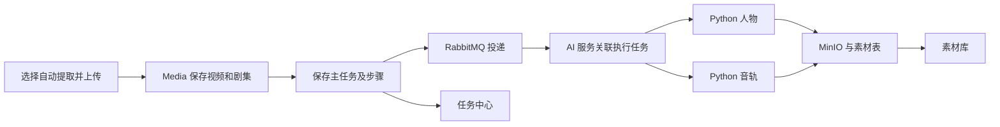

# 上传与自动提取流程

前端先查询提取能力，上传时提交自动提取选项。Media 复用原视频上传的项目锁、MP4 检查、MinIO 写入和剧集绑定。
自动提取在视频提交之后执行独立事务，写入主任务和步骤。失败时视频仍然可播放，可以通过任务中心补建。
新接口见 [前端提取 API](frontend-extraction-api.md)。

本地开发先运行 Auth 应用 Flyway V7，再启动 Media、Gateway、Java AI 和 Python。Java AI 默认连接
`CHARACTER_PYTHON_URL=http://127.0.0.1:19000`。共享路径、Python 单进程和权重配置沿用
[人物提取服务配置](frontend-character-extraction-api.md#本地联调与部署)。Media 与 Java AI 使用同一
`EXTRACTION_SUPPORTED_TYPES`，默认 `CHARACTER,AUDIO`，可按部署环境关闭某项。可用类型来自当前接入的真实 Python 接口。

- 人物沿用 `/internal/v1/character-extraction/tasks`，继续使用 FFmpeg 抽帧和既有人物检测、分割模型。
- 音轨使用 `/internal/v1/asset-extraction/tasks`，只传 `outputs:["AUDIO"]`，从共享目录导入 16 位 PCM WAV。
- 两类步骤互相独立。正常创建优先复用同一源视频已完成的结果。同一集不同类型组合可以共享已有执行任务。
- Python 人物接口的输入是视频和采样间隔。显式重新提取人物时，由 Python 按当前协议抽帧。
- 现有 Java 首帧 API 保留。当前 Python 服务未提供完整分镜、对白、背景或剧情任务协议。

新任务中心及素材查询供前端切换使用。旧上传、首帧和人物 API 保留原路径与响应结构。
