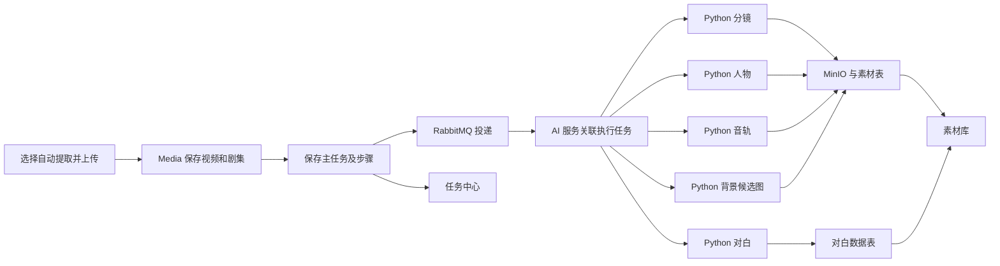

# 上传与自动提取流程

前端先查询提取能力，上传时提交自动提取选项。Media 复用原视频上传的项目锁、MP4 检查、MinIO 写入和剧集绑定。
自动提取在视频提交之后执行独立事务，写入主任务和步骤。失败时视频仍然可播放，可以通过任务中心补建。
新接口见 [前端提取 API](frontend-extraction-api.md)。

本地开发先运行 Auth 应用 Flyway V10，再启动 Media、Gateway、Java AI 和 Python。Java AI 默认连接
`CHARACTER_PYTHON_URL=http://127.0.0.1:19000`。共享路径、Python 单进程和权重配置沿用
[人物提取服务配置](frontend-character-extraction-api.md#本地联调与部署)。Media 与 Java AI 使用同一
`EXTRACTION_SUPPORTED_TYPES`，默认 `SHOT,CHARACTER,AUDIO`。Python 继续使用端口 `19000`。

对白部署先确认 Python 已安装 `dialogue` 依赖、转写模型权重就绪并能完成 `outputs:["DIALOGUE"]`。
本地可在 Python 仓库运行 `uv sync --extra characters --extra dialogue`，沿用同一套共享目录启动服务。
应用 V9 并按 [数据库授权](database.md#v9-对白提取) 补齐权限后，两边同步配置
`EXTRACTION_SUPPORTED_TYPES=SHOT,CHARACTER,AUDIO,DIALOGUE`。

Python 部署版可完成 `outputs:["BACKGROUND"]` 后，在 Media 和 Java AI 已启用类型中同步追加
`BACKGROUND`，例如 `EXTRACTION_SUPPORTED_TYPES=SHOT,CHARACTER,AUDIO,DIALOGUE,BACKGROUND`。
Python 需能从共享输出目录读取此前发布的分镜清单。该目录保留仍有复用需求的分镜产物。

- 人物沿用 `/internal/v1/character-extraction/tasks`，继续使用 FFmpeg 抽帧和既有人物检测、分割模型。
- 音轨使用 `/internal/v1/asset-extraction/tasks`，只传 `outputs:["AUDIO"]`，从共享目录导入 16 位 PCM WAV。
- 分镜使用 `/internal/v1/asset-extraction/tasks`，只传 `outputs:["SHOTS"]`，从共享目录导入 `shots.json` 和代表图。
- 对白使用同一个素材任务接口，只传 `outputs:["DIALOGUE"]`，读取同次执行发布的 `dialogue.json`，完整写入对白表。
- 背景使用同一个素材任务接口，只传 `outputs:["BACKGROUND"]`。首次提交时有当前原视频的成功分镜则传
  `shotManifestRef`，否则省略，由 Python 在本次背景任务内检测分镜。Java 当前按步骤分别提交。
- 各步骤互相独立。正常创建优先复用同一源视频已完成的结果。同一集不同类型组合可以共享已有执行任务。
- Python 人物接口的输入是视频和采样间隔。显式重新提取人物时，由 Python 按当前协议抽帧。
- 现有 Java 首帧 API 保留。正式分镜未发布时素材库仍可回读历史首帧。剧情使用能力查询中的支持状态。

新任务中心及素材查询供前端切换使用。旧上传、首帧和人物 API 保留原路径与响应结构。
